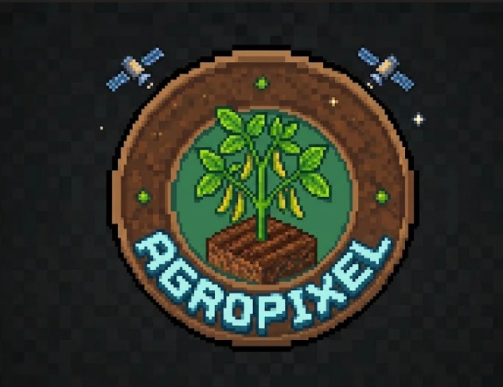
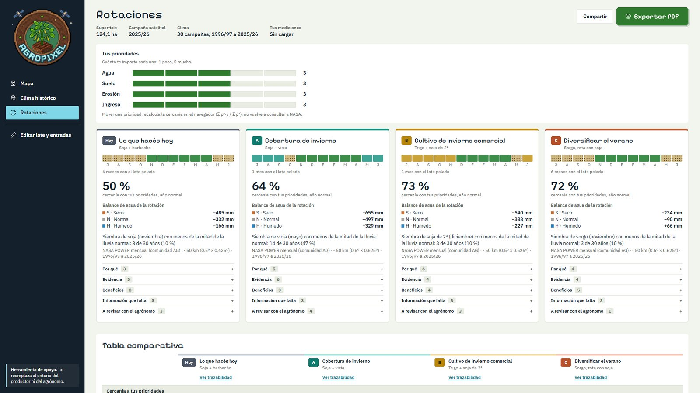
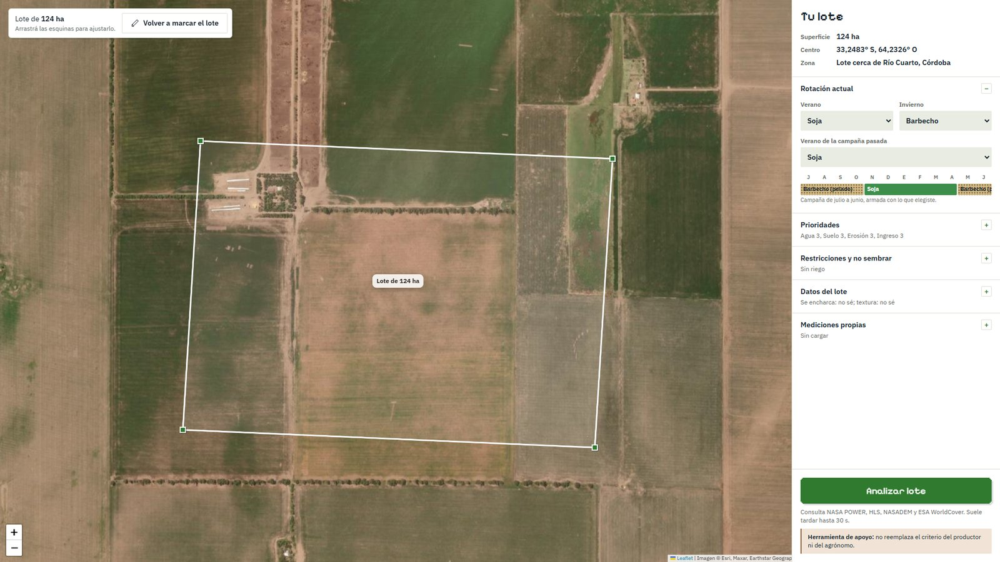
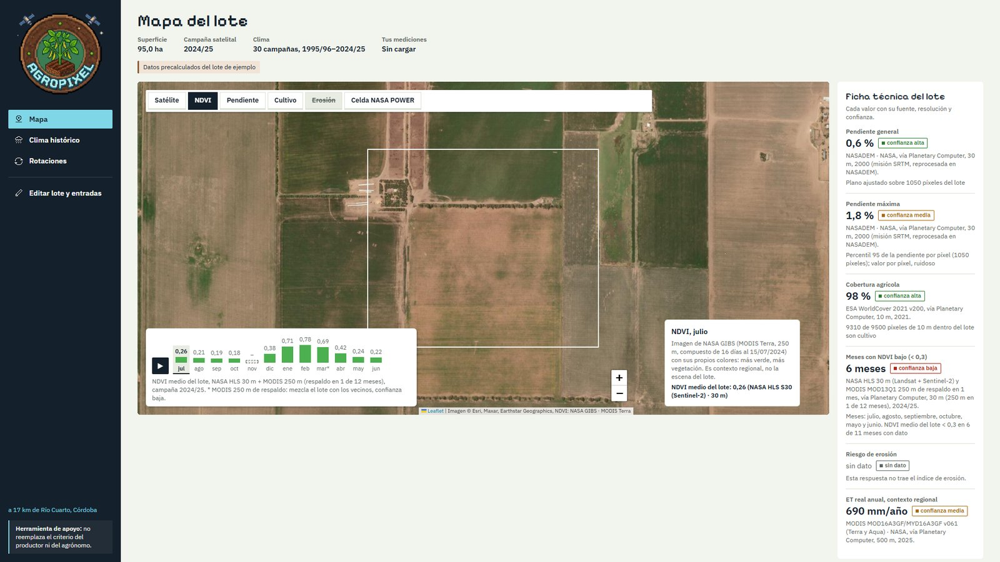
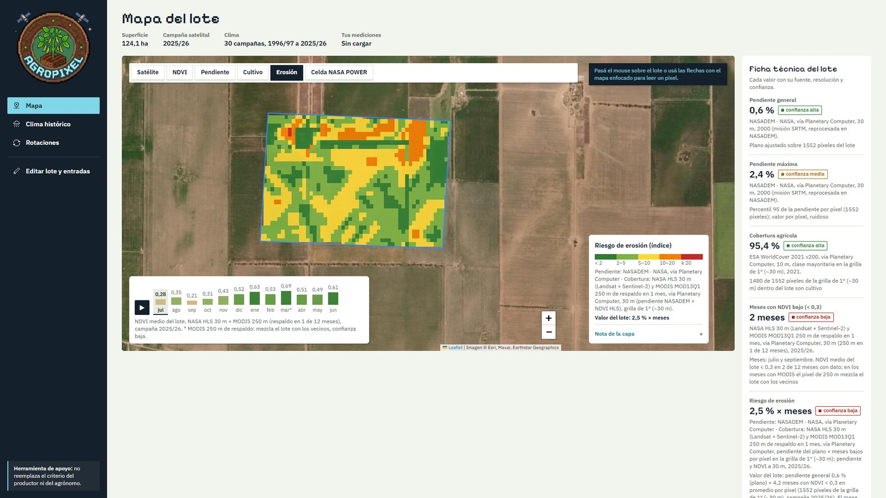
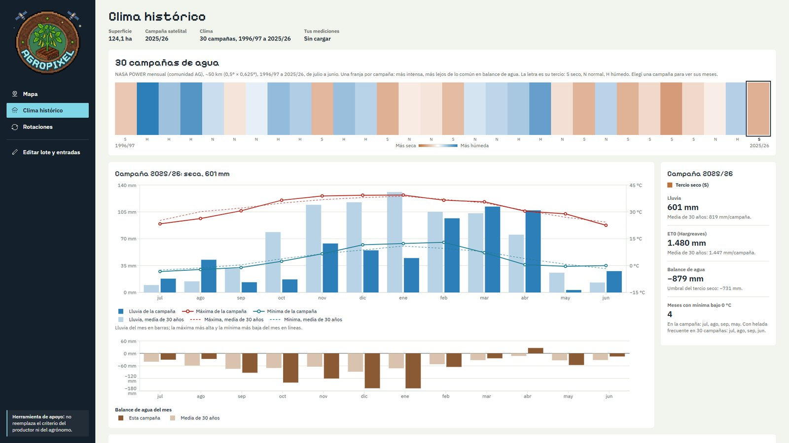
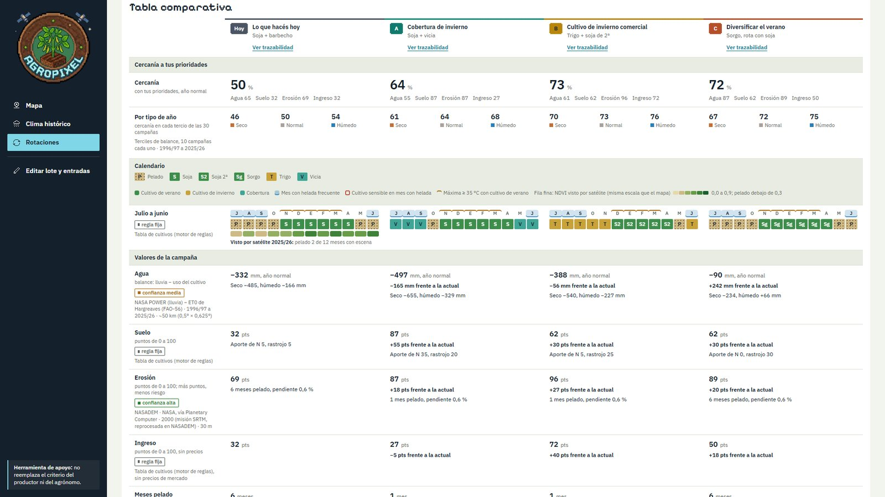
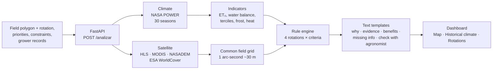

<p align="center">
  <br>
  <sub>Logo: AI-generated (see <a href="#use-of-ai-tools">Use of AI tools</a>)</sub>
</p>

<h1 align="center">AgroPixel</h1>

<p align="center">
  <strong>Compare crop rotations on your own field, with 30 seasons of NASA data.</strong><br>
  NASA Space Apps Challenge 2026 · Córdoba, Argentina · Challenge: <em>Field Shift: Adapting Farms with NASA Data</em>
</p>

<p align="center">
  <a href="https://agropixel.earth"><strong>🌱 Live app: agropixel.earth</strong></a>
  &nbsp;·&nbsp;
  <a href="https://youtu.be/3xEYUBRogrE"><strong>▶️ Demo video</strong></a>
</p>

<p align="center">
  
</p>

---

## Contents

- [Summary](#summary)
- [Try it](#try-it)
- [Screenshots](#screenshots)
- [What it does](#what-it-does)
- [How it works](#how-it-works)
- [NASA data](#nasa-data)
- [Space Agency Partner data and other resources](#space-agency-partner-data-and-other-resources)
- [Design principles](#design-principles)
- [Why it matters](#why-it-matters)
- [Tech stack](#tech-stack)
- [Repository structure](#repository-structure)
- [Run it locally](#run-it-locally)
- [Testing and CI](#testing-and-ci)
- [Deployment](#deployment)
- [Limitations](#limitations)
- [Roadmap](#roadmap)
- [Glossary of interface terms (Spanish → English)](#glossary-of-interface-terms-spanish--english)
- [Use of AI tools](#use-of-ai-tools)
- [Team](#team)

---

## Summary

AgroPixel is a web decision-support tool that helps growers and their agronomists compare crop rotations using NASA data. The user outlines a field on a satellite map and enters the current rotation, priorities (water, soil health, erosion, income) and constraints. AgroPixel then compares that rotation with three alternatives: a **winter cover crop** (hairy vetch or cereal rye), a **commercial winter crop** (wheat or barley followed by double-crop soybean) and **summer diversification** (sorghum or sunflower).

Each option is evaluated against **30 growing seasons of NASA POWER climate data**, **HLS NDVI at 30 m**, **NASADEM slope** and **ESA WorldCover**. Results show the trade-offs in water balance, ground cover, nitrogen contribution, erosion risk and income, broken down by dry, normal and wet years, with the observed frequency of frost, heat stress and dry sowing windows.

**AgroPixel compares; it does not recommend.** The decision stays with the grower and the agronomist.

## Try it

1. Open **[agropixel.earth](https://agropixel.earth)**.
2. Find your field: search a place, paste coordinates or a Google Maps link, or use **"Usar mi ubicación"** (*Use my location*). For a quick test, go to the Río Cuarto area in Córdoba (≈ 33.2477° S, 64.2325° W), the reference field the team used during development.
3. Click each corner of the field on the map and close it with **"Listo"** (*Done*).
4. Fill in the side panel (current rotation, priorities, constraints) and click **"Analizar lote"** (*Analyze field*).
5. Explore the dashboard: **Mapa** (*Map*), **Clima histórico** (*Historical climate*) and **Rotaciones** (*Rotations*).

> The interface is in Spanish, because the target users are Argentine growers and agronomists. The [glossary](#glossary-of-interface-terms-spanish--english) maps every agronomic term in the interface to its English equivalent.

Prefer to watch? The **[demo video](https://youtu.be/3xEYUBRogrE)** walks through the whole flow.

## Screenshots

Captured from [agropixel.earth](https://agropixel.earth) on 15 November 2026, with live data: a 124 ha field near Río Cuarto, Córdoba, with soybean and winter fallow, 2025/26 season, 30 climate seasons from 1996/97 to 2025/26. The screenshots include the AI-generated AgroPixel logo.

**1. Field and inputs.** The field outlined on the satellite map, and the side panel with the current rotation (soybean + winter fallow, shown as a July–June calendar), priorities, constraints, field data and the grower's own records.



**2. Map: NDVI per pixel.** The HLS NDVI of the field on its 1 arc-second (~30 m) grid for July 2025, the monthly NDVI timeline of the season, and the field's technical sheet. Every value shows its source, resolution and confidence.



**3. Map: erosion risk per pixel.** NASADEM slope multiplied by the months of low ground cover seen by HLS, pixel by pixel. The field value in the table is the summary of this layer.



**4. Historical climate.** The 30 seasons, one stripe each: the color is more intense the further the season's water balance is from normal, and the letter gives its tercile (S dry, N normal, H wet). The selected season (2025/26, dry, 601 mm) shows its monthly rainfall, temperature extremes and water balance against the 30-year mean.



**5. Rotations.** The priorities and the four rotations, each with its July–June calendar, months of bare soil, goal fit score, water balance by year type, its first climatological probability, and the five parts of the column.


**6. Comparison table.** Goal fit score by criterion and by year type, the calendars with frost and heat markers and the NDVI seen by satellite, and each value with its source, confidence and difference from the current rotation. It can be exported to PDF.



## What it does

### Inputs
- **Field:** a polygon drawn by the user, from 1 to 20,000 ha, with no self-intersections.
- **Current rotation:** summer crop, winter crop or fallow, and last season's crop.
- **Priorities** from 1 to 5: water, soil health, erosion and income.
- **Constraints:** rainfed (no irrigation), no livestock, limited machinery, excluded crops.
- **Field data:** soil texture and whether the field is prone to waterlogging.
- **Grower records (optional):** a CSV file with daily or monthly rainfall from the farm's rain gauge and, if the farm has a weather station, minimum and maximum temperature. There is no manual entry in the app.

### The dashboard
- **Map:** satellite layers clipped to the field: monthly NDVI with a 12-month timeline, slope, cropland and per-pixel erosion risk, plus the NASA POWER grid cell. Hovering over a pixel shows its value and source. Every layer is drawn at the real resolution of its data.
- **Historical climate:** the last 30 growing seasons (July–June), colored by dry, normal or wet year. Selecting a season shows its 12 months of rainfall, minimum and maximum temperature, reference evapotranspiration and water balance against the 30-year mean. Frost and heat frequencies by month, and a side-by-side comparison with the grower's own records.
- **Rotations:** the current rotation and three alternatives, as cards and as a technical table that can be exported to PDF.

| Column | Strategy |
|---|---|
| **Current** | The rotation the user entered |
| **A · Winter cover crop** | Same summer crops + hairy vetch or cereal rye in the winter fallow window |
| **B · Commercial winter crop** | Wheat or barley followed by double-crop soybean |
| **C · Summer diversification** | Sorghum or sunflower added to the sequence |

Every column always has the same five parts: **why** this option, **evidence** (with sources such as INTA field trials), **benefits**, **missing information** and **what to check with your agronomist**. An alternative excluded by a constraint stays visible, greyed out, with the reason.

## How it works



### Climate
- **One request** to the NASA POWER monthly API covers the last 30 complete July–June growing seasons for the field's location.
- **Reference evapotranspiration (ET₀)** comes from the Hargreaves equation (FAO-56), using mean temperature, the diurnal temperature range and extraterrestrial radiation for the field's latitude.
- **Water balance** = precipitation − ET₀. The 30 seasons are ranked by water balance and split into terciles: **dry, normal and wet years**.
- **Frost** (monthly minimum < 0 °C) and **heat stress** (monthly maximum ≥ 35 °C) are counted month by month.

### Satellite
Everything is computed over the field polygon, not a single point:
- **HLS NDVI (30 m)**, month by month for the latest season, gives the **months of low ground cover** the field actually had (NDVI < 0.3). **MODIS** is the fallback when a month has no clear HLS scene. If that observed bare-soil pattern does not match the rotation the user declared, the app flags it for review.
- **NASADEM slope**, combined pixel by pixel with the bare-soil months, gives an **erosion-risk** layer.
- **ESA WorldCover** checks that the polygon is cropland before the result is built.
- **MODIS evapotranspiration** cross-checks the ET₀ estimate.
- All layers are resampled to a **common 1 arc-second (~30 m) grid** (2 arc-seconds or more for very large fields, to stay under 250,000 pixels per layer), so each field-level number in the table is the summary of a layer the user can see on the map.

### Rule engine
Fixed, documented agronomic rules ([`backend/app/motor`](backend/app/motor)) score each rotation on:
- **Water:** crop water use (crop coefficient × ET₀) against rainfall, in dry, normal and wet years.
- **Soil health:** nitrogen contribution (biological N fixation by legumes), crop residue, months of ground cover, and a penalty for repeating last season's crop.
- **Erosion:** months of bare soil weighted by slope, by the rainfall in those months and by soil texture (sandy soils score worse).
- **Income:** a relative index between crops (no market prices).

A **goal fit score** combines the four criteria, weighting each by the **square** of the user's priority: `Σ p²·v / Σ p²`. Excluded crops choose the species (for example, barley instead of wheat) and grey out an alternative, with the reason shown, only when all its options are excluded. The other constraints do not remove columns: limited machinery adds a review note to B and C.

### Climatological probability
For each rotation's calendar, AgroPixel counts how often key events occurred in the 30 seasons:
- frost while a frost-sensitive crop is in the field;
- sowing with less than half the normal rainfall for that month;
- maximum temperature ≥ 35 °C during a summer crop.

It always shows the year count, not just a percentage. Example: *"Hairy vetch sowing (May) with less than half the normal rainfall: 14 of 30 years (47%)."* These are **observed frequencies**, not a predictive model.

### Grower records
NASA is the baseline; the grower's own data weighs more:
- **Contrast:** the grower's rainfall and temperatures are compared with NASA POWER **over the same seasons**. If rainfall differs by more than 15%, the confidence of the water results drops to "low" and the difference goes to "check with your agronomist".
- **Blending:** the grower's records are blended with NASA in the scores, weighted by years of record: 1–2 years 40%, 3–4 years 50%, 5–9 years 60%, 10 or more 75%. Every value states how much each source contributed.
- The CSV parser detects encoding, `;` or `,` separators and decimal commas, and returns a preview with warnings by row. Nothing is stored.

## NASA data

| Source | Product / parameters | Resolution | What AgroPixel derives from it |
|---|---|---|---|
| **NASA POWER** (Agroclimatology, `AG` community) | Monthly Point API: `PRECTOTCORR_SUM`, `T2M`, `T2M_RANGE`, `T2M_MIN`, `T2M_MAX` | 0.5° × 0.625° (~50 km) | 30 July–June seasons: rainfall, ET₀ (Hargreaves), water balance, dry/normal/wet terciles, frost and heat frequencies, climatological probabilities, historical climate charts |
| **HLS** (Harmonized Landsat and Sentinel-2, v2.0) | `HLSS30` (B04, B08) and `HLSL30` (B04, B05) | 30 m | Monthly NDVI of the field, months of low ground cover, NDVI map layer and timeline |
| **MODIS MOD13Q1 v6.1** | 16-day NDVI, `pixel_reliability` band | 250 m | NDVI fallback when a month has no clear HLS scene |
| **MODIS MOD16A3GF v6.1** | Yearly gap-filled evapotranspiration | 500 m | Actual annual ET, to cross-check ET₀ |
| **NASADEM** | Elevation | 1 arc-second (~30 m) | Slope, per-pixel erosion risk and the common grid for all field layers |
| **NASA GIBS** | `MODIS_Terra_L3_NDVI_16Day` (WMTS) | 250 m | Visual NDVI layer around the field, by date |

**Access:**
- NASA POWER and GIBS are queried directly.
- HLS, MODIS and NASADEM (distributed by NASA's LP DAAC) are read as STAC collections in [Microsoft Planetary Computer](https://planetarycomputer.microsoft.com), which needs no login and returns statistics per polygon in seconds.
- All sources share the same season, the latest complete one in NASA POWER, reported by the API and never hard-coded.

**Considered and discarded:**
- SMAP: requires an Earthdata login and starts in 2015, too short for 30 seasons.
- GRACE: regional scale only.
- ECOSTRESS: irregular overpasses.
- ERA5 and GPM in Planetary Computer: heavy Zarr stores that only reach ~2021.

## Space Agency Partner data and other resources

| Resource | Use |
|---|---|
| **ESA WorldCover** (European Space Agency), 10 m | Checks that the field is cropland; cropland map layer |
| **Microsoft Planetary Computer** | STAC catalog and polygon statistics for HLS, MODIS, NASADEM and WorldCover |
| **FAO Irrigation and Drainage Paper 56** (Allen et al., 1998) | Hargreaves ET₀ and extraterrestrial radiation equations |
| **INTA** (Argentina's National Institute of Agricultural Technology) | Field-trial evidence cited in the rotation texts (for example, cover crop water use in dry years, INTA Manfredi) |
| **Esri World Imagery** and **Esri World Geocoding** | Satellite basemap and place search |
| **Leaflet** (open source) | Interactive map component |

## Design principles

- **Compares, does not recommend.** The app never says which option is "best" or what the grower "should" do. Texts describe data: *"5 more months of ground cover, −60 mm of water balance in dry years."* A CI check blocks prescriptive wording in the app's texts.
- **No AI inside the app.** No language models or machine learning at runtime. Everything comes from fixed rules, statistics and text templates, so results are reproducible and explainable.
- **Traceable.** Every value shows its unit, source, years, resolution and confidence, and every text can be traced to the data and rule that produced it.
- **Nothing invented.** Missing or low-confidence data goes to "Missing information"; it is never filled in.
- **Standardized.** Always the same four columns and the same five parts per column.
- **Technical by default.** The users are experienced growers and agronomists.
- **Supports, does not replace.** The notice *"Decision-support tool: it does not replace the judgment of the grower or the agronomist"* is always visible.

## Why it matters

In Argentina's Pampas, continuous soybean with long winter fallows depletes soil organic matter, increases water erosion and leaves farms more exposed to drought. Cover crops and more diverse rotations help, but adoption is limited: growers need to see the trade-offs **on their own field, under their own climate**, before changing a system that pays today.

AgroPixel puts that evidence on the table in the conversation between grower and agronomist: how much water a cover crop would use in a dry year, how many months of bare soil a rotation removes, and how often frost or a dry sowing window would have hurt it in the last 30 seasons.

## Tech stack

| Layer | Technologies |
|---|---|
| Frontend | TypeScript, Next.js 15, React 19, Leaflet / React Leaflet, Recharts, Zustand, Tailwind CSS |
| Backend | Python 3.12+, FastAPI, Pydantic v2, httpx, NumPy, Pillow |
| Data access | NASA POWER API, Microsoft Planetary Computer (STAC + statistics API), NASA GIBS WMTS |
| Infrastructure | Google Cloud Run (API and web), HTTPS load balancer for `agropixel.earth`, GitHub Actions (CI and deploy with Workload Identity Federation) |
| Quality | ruff, pytest (offline tests), ESLint, TypeScript, Vitest, gitleaks, custom project checks |
| Design | Figma |

## Repository structure

```
.
├── backend/                  Python + FastAPI, organized by domain
│   ├── app/
│   │   ├── api/              API contract (contrato.py), routes, mock
│   │   ├── clima/            NASA POWER, ET₀, terciles, probabilities, grower contrast
│   │   ├── satelite/         HLS / MODIS NDVI, NASADEM slope, WorldCover, ET, map layers
│   │   ├── mediciones/       Grower CSV parser
│   │   ├── motor/            Rule engine, crops, strategies, text templates
│   │   ├── demo/             Precomputed response for the example field
│   │   ├── servicio.py       Orchestrates all domains for /analizar
│   │   └── main.py           FastAPI app
│   ├── scripts/              precalcular_demo.py
│   └── tests/                pytest suite (no network)
├── frontend/                 Next.js app (marcar → configurar → cargando → dashboard)
│   ├── src/components/       marcar, entradas, carga, dashboard, mapa, clima, resultados
│   ├── src/lib/              API client, contract types, formatting, state
│   └── public/img/           Logo
├── docs/                     Scope (MVP), API guide, layer harmonization, CSV format, QA
└── .github/                  CI workflows and project checks
```

The internal documentation is in Spanish. Key documents:
- [`docs/mvp-alcance.md`](docs/mvp-alcance.md): scope, screens and requirements.
- [`docs/api-frontend.md`](docs/api-frontend.md): API guide.
- [`backend/app/api/contrato.py`](backend/app/api/contrato.py): the API contract, in code.
- [`backend/app/motor/README.md`](backend/app/motor/README.md): the rule engine.
- [`docs/plan-armonizacion-capas.md`](docs/plan-armonizacion-capas.md): layer harmonization.

## Run it locally

### Backend
Requires Python 3.12 or newer.

```bash
cd backend
python -m venv .venv
source .venv/bin/activate          # Windows: .venv\Scripts\activate
pip install -r requirements.txt
uvicorn app.main:app --reload --port 8000
```

Interactive API docs: <http://localhost:8000/docs>.

| Endpoint | Description |
|---|---|
| `GET /salud` | Health check |
| `POST /analizar` | Field + rotation + priorities → full comparison (4 rotations, climate, map layers) |
| `POST /mediciones/planilla` | Grower CSV file → normalized monthly series with warnings |

Example request: [`backend/tests/ejemplos/entrada_demo.json`](backend/tests/ejemplos/entrada_demo.json).

```bash
curl -X POST http://localhost:8000/analizar \
  -H "Content-Type: application/json" \
  -d @tests/ejemplos/entrada_demo.json
```

Environment variable: `CORS_ORIGINS`, the allowed origins separated by commas (default `http://localhost:3000`). No API keys are needed: every data source is open.

### Frontend
Requires Node.js 20 or newer (CI runs on 22, production on 24).

```bash
cd frontend
cp .env.example .env.local
npm ci
npm run dev                        # http://localhost:3000
```

| Variable | Value |
|---|---|
| `NEXT_PUBLIC_USAR_MOCK` | `true` uses a built-in mock response; `false` calls the API |
| `NEXT_PUBLIC_API_URL` | API URL without a trailing slash, for example `http://localhost:8000` |

## Testing and CI

GitHub Actions runs on every pull request to `dev` and `main`:

- **Backend:** `ruff check` and `pytest --disable-socket`. More than 400 tests, all offline, using recorded NASA POWER and satellite responses.
- **Frontend:** `npm run lint`, `typecheck`, `npm test` (Vitest) and `npm run build`.
- **Secrets:** gitleaks over the diff and the full history.
- **Project checks** ([`.github/scripts`](.github/scripts)):
  - no prescriptive language in the app;
  - backend domains do not import each other;
  - no heavy or raw data files;
  - no `.env` files committed.

Run the backend tests locally:

```bash
cd backend
pip install -r requirements-dev.txt
pytest --disable-socket
```

## Deployment

- **Web:** [agropixel.earth](https://agropixel.earth), served by Google Cloud Run (`agropixel-web`) behind an HTTPS load balancer.
- **API:** Google Cloud Run (`field-shift-api`, `southamerica-east1`).
- Every push to `main` deploys whatever changed through [`deploy.yml`](.github/workflows/deploy.yml), with keyless authentication (Workload Identity Federation), and then checks that both services respond.
- **Fallback:** if NASA POWER does not respond and the request is marked as the example field (`lote.tipo = "ejemplo"`), the API serves the precomputed response for the reference field near Río Cuarto ([`backend/app/demo/rio_cuarto.json`](backend/app/demo/rio_cuarto.json)), clearly labelled as such.

Details: [`backend/DEPLOY.md`](backend/DEPLOY.md).

## Limitations

- **Climate is regional.** NASA POWER has a ~50 km resolution, so one value covers the whole field. The app labels it "regional context" and invites growers to add their own rain-gauge records.
- **Monthly data.** NASA POWER monthly minimum and maximum temperatures are monthly extremes. Frost and heat are reported as "years with at least one event in that month", not as daily counts.
- **One season of satellite cover.** Ground cover comes from the latest season's NDVI. Cloudy months with no clear scene are reported as missing.
- **Erosion and income are relative indices**, not tonnes of soil or currency. They compare options with each other on the same field.
- **Calibrated for the Argentine Pampas.** Crop coefficients, calendars and evidence texts come from Argentine agronomic practice and INTA trials. The app accepts any field in the Southern Hemisphere (northern-hemisphere fields are rejected, because the calendars, the July–June season and the terciles are southern), but its rules have not been validated outside this region.
- **Rules are not yet field-validated** by an independent agronomic panel.

## Roadmap

- Validate the rules and thresholds with INTA researchers and local agronomists.
- Add daily NASA POWER data and national weather-station networks.
- Extend the crop list (for example, pastures) and calibrate other regions.
- English interface.

## Glossary of interface terms (Spanish → English)

| Spanish (interface) | English |
|---|---|
| Lote | Field |
| Productor / agrónomo, asesor | Grower / agronomist, crop advisor |
| Campaña (julio–junio) | Growing season (July–June), e.g. "2024/25 season" |
| Rotación / secuencia | Crop rotation / crop sequence |
| Cultivo de cobertura (de servicio) | Cover crop |
| Barbecho invernal | Winter fallow |
| Hueco invernal | Winter fallow window |
| Soja de 2ª | Double-crop soybean |
| Monocultivo de soja | Continuous soybean |
| Vicia | Hairy vetch (*Vicia villosa*) |
| Centeno | Cereal rye (*Secale cereale*) |
| Maíz · Sorgo · Girasol · Maní · Trigo · Cebada | Maize (corn) · Grain sorghum · Sunflower · Peanut · Wheat · Barley |
| Rastrojo | Crop residue |
| Cobertura del suelo / meses con cobertura baja / lote pelado | Ground cover / months of low ground cover / bare soil |
| Aporte de N / fija nitrógeno | Nitrogen contribution / biological N fixation |
| Balance hídrico | Water balance (precipitation − ET₀) |
| ET de referencia / ET real | Reference evapotranspiration (ET₀) / actual evapotranspiration |
| Años secos / normales / húmedos | Dry / normal / wet years (terciles) |
| Helada / helada frecuente | Frost / frequent frost |
| Calor (máxima ≥ 35 °C) | Heat stress (Tmax ≥ 35 °C) |
| Siembra | Sowing (planting) |
| Pendiente / erosión hídrica | Slope / water erosion |
| Anegable | Prone to waterlogging |
| Textura del suelo / materia orgánica | Soil texture / soil organic matter |
| Pluviómetro / planilla | Rain gauge / spreadsheet (CSV file) |
| Sin riego / sin hacienda / maquinaria limitada | Rainfed / no livestock / limited machinery |
| No sembrar | Excluded crops |
| Agua · Salud del suelo · Erosión · Ingreso | Water · Soil health · Erosion · Income |
| Prioridades | Priorities |
| Cercanía a tus prioridades | Goal fit score |
| Probabilidad climatológica | Climatological probability |
| Visto por satélite | Observed by satellite |
| Información que falta | Missing information |
| Revisar con el agrónomo | Check with your agronomist |
| Herramienta de apoyo | Decision-support tool |

## Use of AI tools

- **Inside the app:** none. AgroPixel uses no language models or machine learning at runtime; every result comes from fixed rules, statistics and text templates.
- **Code and documentation:** the team used **Claude Code** (Anthropic) as a programming assistant to write, review, test and document code. The idea, the agronomic approach, the rules and every product decision were defined by the team.
- **Images:** the **AgroPixel logo** ([`frontend/public/img/agropixel-logo.png`](frontend/public/img/agropixel-logo.png), also used as the favicon) and the **pixel-art illustrations** of the interface were generated with AI tools. They also appear in the screenshots of this README.
- **Video:** the **[demo video](https://youtu.be/3xEYUBRogrE)** was produced with AI tools.
- No NASA logos, flags or mission identifiers were used or modified in any AI-generated content.

## Team

**TMDO**, a team of four from FCEFyN, Universidad Nacional de Córdoba and one from FaCENA, Universidad Nacional del Nordeste (Argentina):

- Benjamin Martin
- Luca Camaño
- Tobias Roncati
- Valentin Ribero
- Trinidad Cruz

The work was split into five areas:
- **Backend core:** API contract, climate (NASA POWER) and service orchestration.
- **Satellite data and grower records:** HLS, MODIS, NASADEM, WorldCover, the CSV parser and deployment.
- **Product and agronomic logic:** the rule engine and the product definition.
- **Frontend, map and inputs:** field drawing, input panel and map layers.
- **Frontend, results and comparison:** dashboard, rotation cards, technical table and PDF export.

---

<p align="center">
  Made for the <a href="https://www.spaceappschallenge.org">NASA Space Apps Challenge 2026</a>.<br>
  <em>Decision-support tool: it does not replace the judgment of the grower or the agronomist.</em>
</p>
